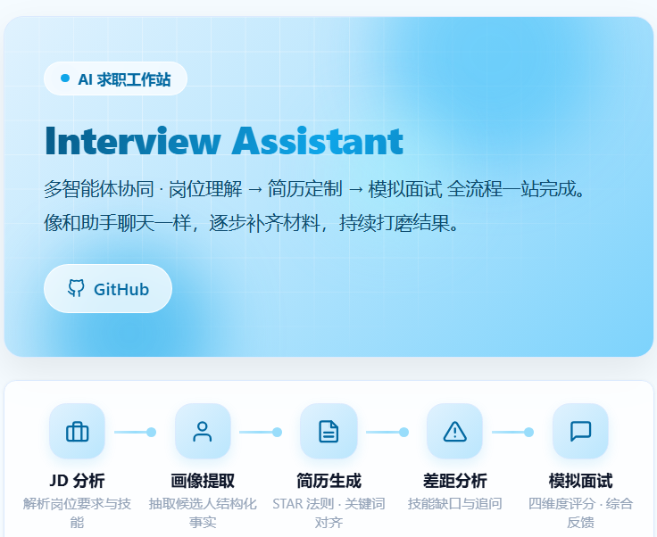
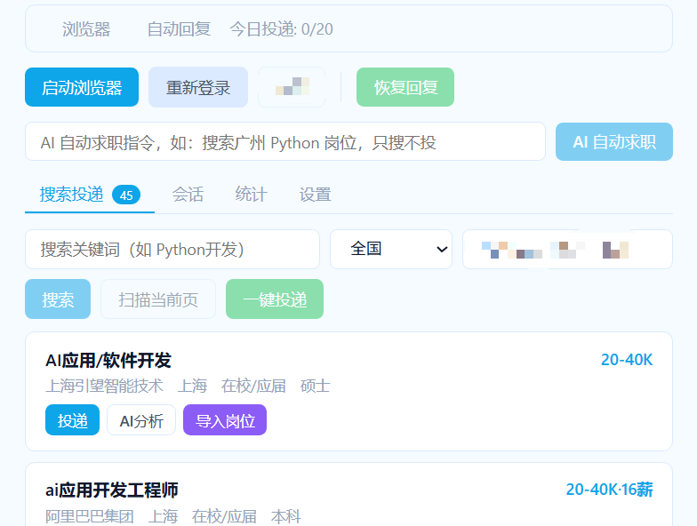
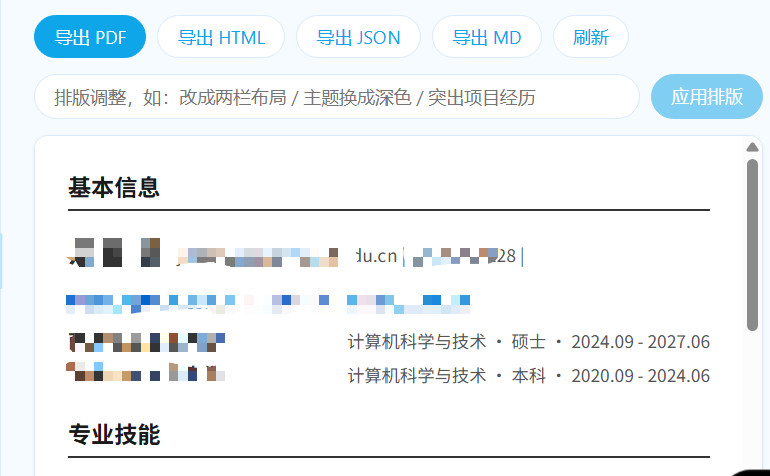
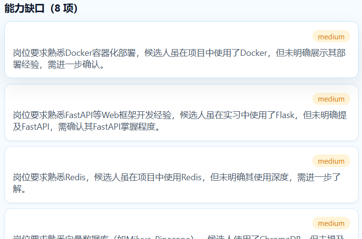
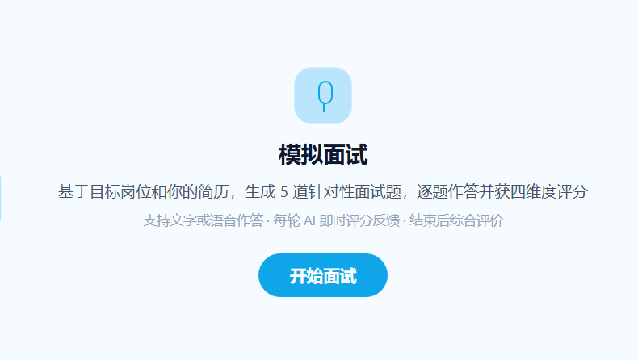
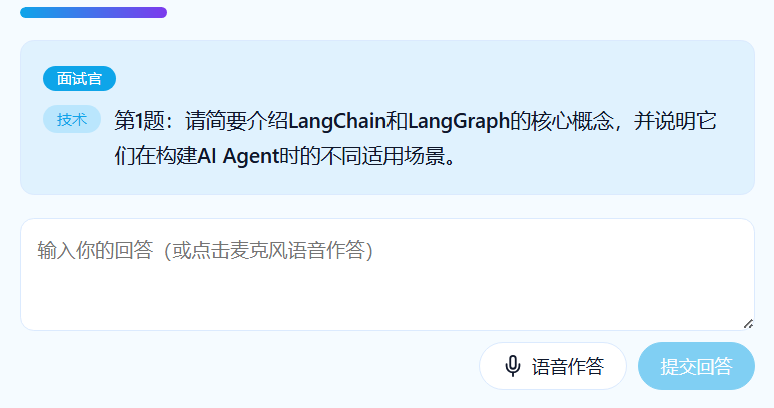

[English](./README.md) | [简体中文](./README.zh-CN.md)

<h1 align="center">🛠️ Find-job Assistant</h1>

<p align="center">
  <b>AI-Powered Multi-Agent Job Application Workstation</b><br/>
  From JD understanding to tailored resumes and mock interviews — all in one conversation.
</p>

<p align="center">
  <a href="#-screenshots">Screenshots</a> · <a href="#-features">Features</a> · <a href="#-architecture">Architecture</a> · <a href="#-quick-start">Quick Start</a> · <a href="#-tech-stack">Tech Stack</a>
</p>

<p align="center">
  
  
  
  
  
  
  
  
  
</p>

---

## 📌 Overview

**Interview Assistant** is an AI-driven, multi-agent collaborative system that covers the full job-hunting journey: **job understanding → candidate profiling → tailored resume generation → gap analysis → interview preparation**.

Instead of a simple "ChatGPT writes my resume", it is a stateful, memory-aware job-hunting workstation where multiple specialized agents work together through a **LangGraph** orchestrated workflow. A unified conversation drives the entire pipeline, and results are incrementally updated across structured panels.

> 🔬 **Notable capabilities**
> - Multi-modal resume parsing: text PDFs, **scanned PDFs (OCR)**, and **image resumes (qwen-vl-ocr)**
> - Agentic RAG with a knowledge base of real interview questions and resume-writing guidance
> - Interactive mock interviews with **voice input**, 4-dimension AI judging, and a final report
> - One-click export to **HTML / Markdown / JSON / PDF**
> - Built-in **BOSS直聘 (BOSS Zhipin)** automation for job search and application

---

## 📸 Screenshots

### 1 · AI Job Workstation

A single conversation drives the whole pipeline — paste a JD, upload your materials, and watch the results build up on the right panel.

<p align="center"></p>

### 2 · BOSS Zhipin Automation

Search, filter, apply, and manage HR conversations inside the built-in BOSS panel, with optional AI-driven autonomous job seeking.

<p align="center"></p>

### 3 · Candidate Profile Extraction

Uploaded resumes (text / scanned / image) are parsed and structured into a candidate profile — education, skills, and experience.

<p align="center"></p>

### 4 · Gap Analysis

The system surfaces capability gaps between the target role and your profile, highlighting what evidence to add or clarify.

<p align="center"></p>

### 5 · Interactive Mock Interview

Generate 5 role-specific questions and answer them one by one, in **text or voice**, with real-time 4-dimension scoring.

<p align="center"></p>

### 6 · Live Interview Q&A

The AI interviewer follows up on your answers, and the Judge agent scores accuracy, depth, expression, and relevance.

<p align="center"></p>

---

## ✨ Features

| Area | What it does |
| --- | --- |
| 🔍 **JD Analysis** | Extracts responsibilities, keywords, and role expectations that drive downstream generation. |
| 👤 **Candidate Profiling** | Parses text / scanned / image resumes via OCR + LLM into structured facts. |
| 📝 **Resume Generation** | LangGraph content agent generates STAR-style, keyword-aligned resume JSON. |
| 🎨 **Resume Rendering** | Template engine renders structured JSON to professional HTML; adjust layout via natural language. |
| 📊 **Gap Analysis** | Compares role requirements vs. candidate capability; surfaces missing or weak evidence. |
| 🗣️ **Mock Interview** | Interactive one-on-one mock interview with voice input and 4-dimension judging. |
| 📚 **Agentic RAG** | Real interview questions + resume guidance knowledge base for retrieval-augmented generation. |
| 📤 **Export** | Export resumes to HTML / Markdown / JSON / PDF. |
| 🤖 **BOSS Zhipin** | Optional browser automation for job search, application, and conversation management. |

---

## 🏗️ Architecture

```
┌─────────────────────────────────────────────────────────────┐
│                    User Interaction (Vue 3)                   │
│   Chat Panel        Result Tabs (Job / Resume / Gaps / ...)  │
└───────────────────────────┬─────────────────────────────────┘
                            │
┌───────────────────────────▼─────────────────────────────────┐
│                     LangGraph StateGraph                      │
│                                                               │
│   Planner ──▶ JD Agent ──▶ Gap Agent ──▶ Content Agent        │
│                 Profile Agent        Render Agent             │
│                 (interview_trigger → REST mock interview)     │
└───────────────────────────┬─────────────────────────────────┘
                            │
   ┌──────────────┬─────────┴───────┬──────────────┬────────────┐
   ▼              ▼                 ▼              ▼            ▼
 Redis        MySQL             ChromaDB        DashScope    Boss
 session      persistence       knowledge       embedding    automation
 state                          vectors        / rerank /    (Playwright)
                                              vision OCR
```

- **Multi-agent orchestration**: LangGraph state graph with a Planner that routes intents to specialized agents; agents communicate only through shared `CopilotState`.
- **Plan Mode**: intent → plan builder → dependency validation → topological execution.
- **Agentic RAG**: `qwen-vl-ocr` for scanned/image OCR, DeepSeek for Q&A structuring, DashScope embeddings + `gte-rerank-v2` rerank, ChromaDB storage.
- **Mock interview**: runs as a dedicated REST flow (start → chat → end) outside the single-pass graph, with voice transcription via DashScope.

---

## 🚀 Quick Start

### Prerequisites

- Python 3.11+
- Node.js 18+
- MySQL 8+ & Redis 6+ (local or via Docker)
- API keys: `DEEPSEEK_API_KEY`, `DASHSCOPE_API_KEY` (and optional `LANGCHAIN_API_KEY`)

### 1 · Install backend dependencies

```bash
pip install -r backend/requirements.txt
```

### 2 · Configure environment

Create `backend/.env`:

```env
DEEPSEEK_API_KEY=your_deepseek_api_key
DASHSCOPE_API_KEY=your_dashscope_api_key
LANGCHAIN_API_KEY=your_langchain_api_key
MYSQL_HOST=127.0.0.1
MYSQL_PORT=3306
MYSQL_USER=root
MYSQL_PASSWORD=change_me
MYSQL_DATABASE=interview_assistant
REDIS_HOST=127.0.0.1
REDIS_PORT=6379
REDIS_DB=0
FASTAPI_HOST=0.0.0.0
FASTAPI_PORT=8000
FASTAPI_DEBUG=true
```

### 3 · Initialize the database

```bash
mysql -u root -p < backend/sql/init_schema.sql
```

### 4 · Start the backend

```bash
python backend/main.py
# health check
curl http://localhost:8000/health
```

### 5 · Start the frontend

```bash
cd frontend
npm install
npm run dev
# → http://localhost:3000
```

### 6 · (Optional) Build the knowledge base

The RAG knowledge base is built from scanned PDFs:

```bash
python scripts/ocr_and_structure.py        # qwen-vl-ocr → Q&A structuring
python scripts/build_knowledge_base.py     # → ChromaDB collections
python scripts/query_knowledge_base.py     # inspect the knowledge base
```

### 7 · (Optional) Evaluate the RAG pipeline

```bash
python scripts/evaluate_rag.py             # RAGAS-style evaluation report
```

---

## 🧰 Tech Stack

| Layer | Technology |
| --- | --- |
| Backend API | FastAPI, Uvicorn |
| Agent orchestration | LangGraph 1.0+ |
| LLM | DeepSeek (`deepseek-chat`) |
| OCR / Vision | DashScope `qwen-vl-ocr` |
| Embedding / Rerank | DashScope `text-embedding-v4` / `gte-rerank-v2` |
| Vector store | ChromaDB |
| Frontend | Vue 3, Vite, Axios |
| Session store | Redis |
| Persistence | MySQL |
| Browser automation | Playwright (BOSS Zhipin) |
| PDF export | Playwright (Chromium) |
| Testing | pytest |

---

## 📁 Project Structure

```text
interview-assistant/
├── backend/
│   ├── main.py               # FastAPI entry, startup checks
│   ├── config.yaml           # global YAML config
│   ├── agents/               # LangGraph agents (planner, jd, profile, gap, content, render, interview)
│   ├── workflow/             # state graph, CopilotState, Plan Mode engine
│   ├── boss/                 # BOSS Zhipin automation + AgentLoop harness
│   ├── services/             # knowledge base, RAG, vision OCR, PDF export, file parsing
│   ├── models/               # LLM / embedding / rerank factories
│   ├── api/                  # chat / resume / export / interview / boss routers
│   └── sql/                  # DB schema
├── frontend/
│   └── src/
│       ├── components/       # ChatPanel, ResultPanel, tab panels
│       └── api/              # Axios API client
├── data/knowledge_base/      # knowledge sources (scanned PDFs, OCR, structured JSON)
├── scripts/                  # OCR, KB build, RAG evaluation, PDF export
├── assets/screenshots/       # README screenshots
└── docs/                     # design documents
```

---

## 🗺️ Roadmap

- [x] Multi-modal resume parsing (text / scanned / image)
- [x] Agentic RAG knowledge base + RAGAS-style evaluation
- [x] Interactive mock interview with voice input
- [x] PDF / HTML / JSON / Markdown export
- [x] BOSS Zhipin integration
- [ ] Cross-session memory and user preferences
- [ ] More resume templates and section-level rendering control
- [ ] One-command Docker deployment with provisioned MySQL / Redis

---

## 🤝 Contributing

Issues and pull requests are welcome.

1. Run the backend and frontend locally.
2. Review the design docs under `docs/`.
3. Add or update tests under `backend/test/`.

## 📄 License

This project is open-sourced for learning and research purposes. Please add a `LICENSE` file before treating it as a standard open-source distribution.

## ⭐ Support

If this project helps you, please consider giving it a star. Thank you!
