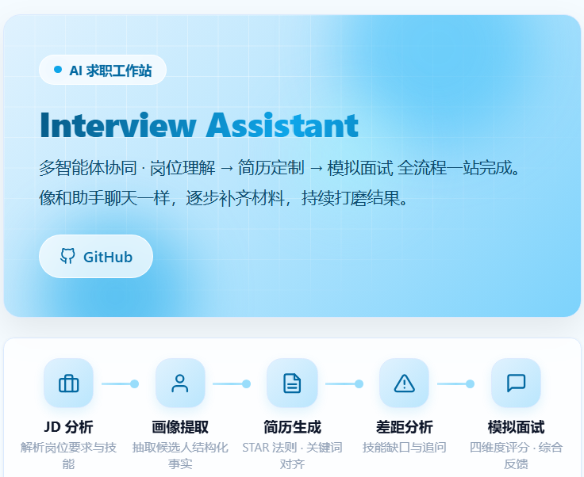
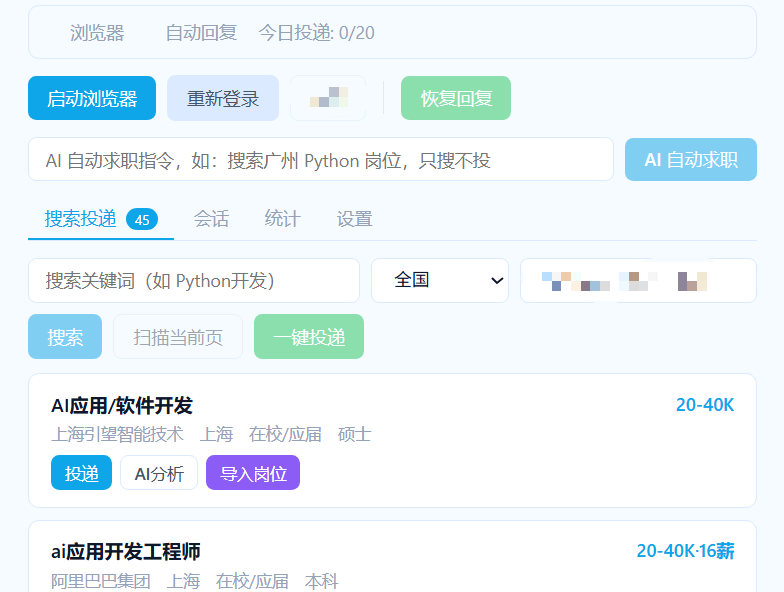
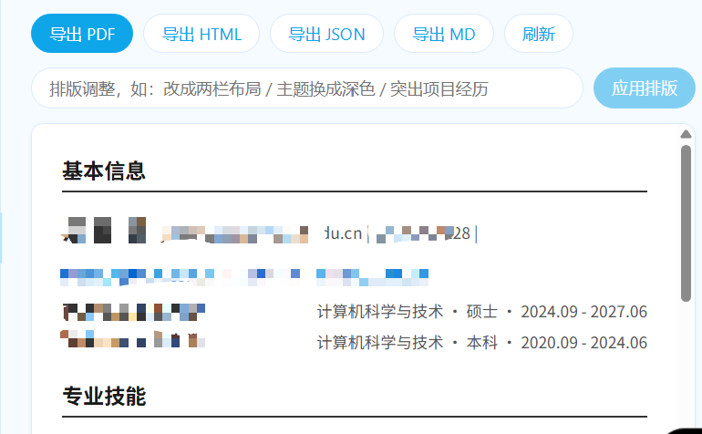
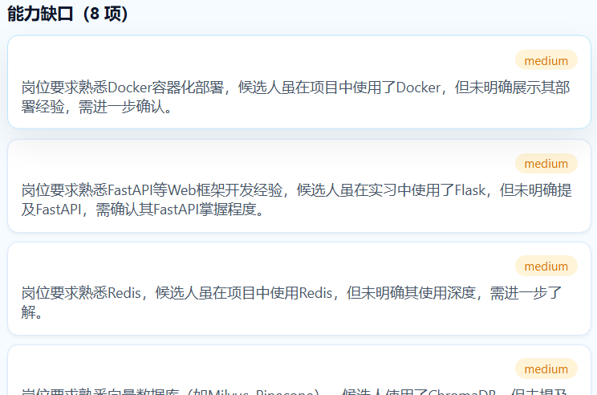
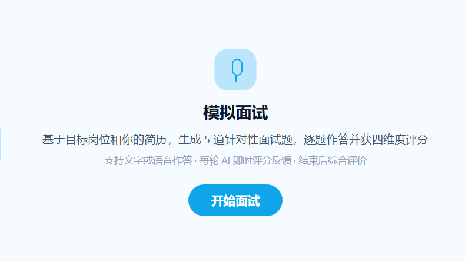
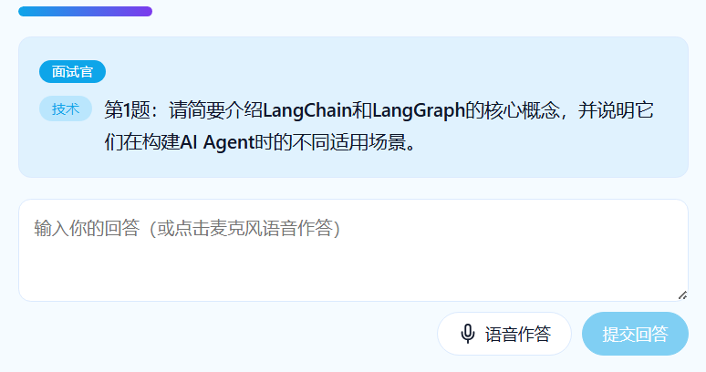

[English](./README.md) | [简体中文](./README.zh-CN.md)


<h1 align="center">🛠️ Find-job Assistant</h1>

<p align="center">
  <b>AI 驱动的多 Agent 智能求职工作站</b><br/>
  从岗位理解到定制简历、再到模拟面试，一站式对话完成。
</p>

<p align="center">
  <a href="#-界面预览">界面预览</a> · <a href="#-核心特性">核心特性</a> · <a href="#-技术架构">技术架构</a> · <a href="#-快速开始">快速开始</a> · <a href="#-技术栈">技术栈</a>
</p>

<p align="center">
  
  
  
  
  
  
  
  
  
</p>

---

## 📌 项目简介

**Interview Assistant** 是一款 AI 驱动的多 Agent 协作求职助手系统，覆盖求职全流程：**岗位理解 → 候选人画像 → 定制简历生成 → 差距分析 → 面试准备**。

它不是简单的"ChatGPT 写简历"，而是一个有状态、有记忆的多 Agent 求职工作站。多个专业智能体通过 **LangGraph** 状态图协同工作，统一的对话驱动整条流水线，结果在右侧结构化面板中持续增量更新。

> 🔬 **核心亮点**
> - **多模态简历解析**：支持文本型 PDF、扫描件 PDF（OCR）、图片简历（qwen-vl-ocr）
> - **Agentic RAG**：真实大厂面试题库 + 简历书写指导知识库
> - **交互式模拟面试**：支持文字/语音作答、Judge 四维度评分、综合评价
> - **一键导出**：HTML / Markdown / JSON / PDF
> - **内置 BOSS 直聘**：岗位搜索、投递、会话管理的浏览器自动化

---

## 📸 界面预览

### 1 · AI 求职工作站

一段对话驱动全流程——粘贴 JD、上传材料，右侧面板实时构建结果。

<p align="center"></p>

### 2 · BOSS 直聘自动化

内置 BOSS 面板中搜索、筛选、投递、管理 HR 会话，并支持 AI 自动求职。

<p align="center"></p>

### 3 · 候选人画像提取

上传的简历（文本/扫描件/图片）经解析后结构化为候选人画像——教育背景、技能与经历。

<p align="center"></p>

### 4 · 能力缺口分析

系统对比目标岗位与候选人能力，标出需要补充或明确的证据项。

<p align="center"></p>

### 5 · 交互式模拟面试

基于岗位生成 5 道针对性题目，逐题作答，支持文字/语音，四维度即时评分。

<p align="center"></p>

### 6 · 面试问答实况

AI 面试官基于回答深入追问，Judge Agent 从准确性/深度/表达/匹配度四个维度打分。

<p align="center"></p>

---

## ✨ 核心特性

| 能力 | 说明 |
| --- | --- |
| 🔍 **JD 分析** | 抽取岗位职责、关键词与能力要求，驱动后续生成。 |
| 👤 **候选人画像** | 文本/扫描件/图片简历经 OCR + LLM 结构化提取。 |
| 📝 **简历生成** | LangGraph Content Agent 生成 STAR 风格、关键词对齐的简历 JSON。 |
| 🎨 **简历渲染** | 模板引擎渲染结构化 JSON 为专业 HTML，支持自然语言调整排版。 |
| 📊 **差距分析** | 对比岗位要求与候选人能力，标出缺失或薄弱证据。 |
| 🗣️ **模拟面试** | 一问一答交互式面试，语音输入 + 四维度评分。 |
| 📚 **Agentic RAG** | 真实面经 + 简历指导知识库，检索增强生成。 |
| 📤 **导出** | 简历导出为 HTML / Markdown / JSON / PDF。 |
| 🤖 **BOSS 直聘** | 可选浏览器自动化，支持岗位搜索、投递与会话管理。 |

---

## 🏗️ 技术架构

```
┌─────────────────────────────────────────────────────────────┐
│                   用户交互层（Vue 3）                         │
│   对话面板        结果 Tab（岗位/简历/缺口/面试/调试/BOSS）   │
└───────────────────────────┬─────────────────────────────────┘
                            │
┌───────────────────────────▼─────────────────────────────────┐
│                  LangGraph 状态图编排                        │
│                                                              │
│  Planner ──▶ JD Agent ──▶ Gap Agent ──▶ Content Agent       │
│               Profile Agent        Render Agent              │
│              (interview_trigger → REST 模拟面试)              │
└───────────────────────────┬─────────────────────────────────┘
                            │
   ┌──────────────┬─────────┴───────┬──────────────┬────────────┐
   ▼              ▼                 ▼              ▼            ▼
 Redis        MySQL             ChromaDB        DashScope    Boss
 会话状态      持久化            知识向量         embedding  自动化
                             (cv/interview)    / rerank /  (Playwright)
                                             视觉OCR
```

- **多 Agent 编排**：LangGraph 状态图，Planner 按意图路由到专业 Agent；Agent 仅通过共享 `CopilotState` 通信。
- **Plan Mode**：意图 → 计划构建 → 依赖校验 → 拓扑执行。
- **Agentic RAG**：`qwen-vl-ocr` 识别扫描件/图片，DeepSeek 结构化 Q&A，DashScope 向量化 + `gte-rerank-v2` 精排，ChromaDB 存储。
- **模拟面试**：独立 REST 流程（start → chat → end），语音经 DashScope 转写。

---

## 🚀 快速开始

### 环境依赖

- Python 3.11+
- Node.js 18+
- MySQL 8+ 与 Redis 6+（本地或 Docker）
- API 密钥：`DEEPSEEK_API_KEY`、`DASHSCOPE_API_KEY`（可选 `LANGCHAIN_API_KEY`）

### 1 · 安装后端依赖

```bash
pip install -r backend/requirements.txt
```

### 2 · 配置环境变量

创建 `backend/.env`：

```env
DEEPSEEK_API_KEY=your_deepseek_api_key
DASHSCOPE_API_KEY=your_dashscope_api_key
LANGCHAIN_API_KEY=your_langchain_api_key
MYSQL_HOST=127.0.0.1
MYSQL_PORT=3306
MYSQL_USER=root
MYSQL_PASSWORD=change_me
MYSQL_DATABASE=interview_assistant
REDIS_HOST=127.0.0.1
REDIS_PORT=6379
REDIS_DB=0
FASTAPI_HOST=0.0.0.0
FASTAPI_PORT=8000
FASTAPI_DEBUG=true
```

### 3 · 初始化数据库

```bash
mysql -u root -p < backend/sql/init_schema.sql
```

### 4 · 启动后端

```bash
python backend/main.py
# 健康检查
curl http://localhost:8000/health
```

### 5 · 启动前端

```bash
cd frontend
npm install
npm run dev
# → http://localhost:3000
```

#### Windows 本机接入观测云

确认 DataKit 的 OpenTelemetry 采集器监听 `127.0.0.1:4317`。
当前本机实例在 `backend/.env` 中使用
`FASTAPI_HOST=127.0.0.1` 和 `FASTAPI_PORT=8001`。
在项目根目录启动后端。

```powershell
$env:OTEL_EXPORTER_OTLP_ENDPOINT='http://127.0.0.1:4317'
$env:OTEL_SERVICE_NAME='interview-assistant-pycharm'
.venv/Scripts/python.exe backend/main.py
```

在另一个终端的 `frontend` 目录启动 Vite。

```powershell
$env:INTERVIEW_API_TARGET='http://127.0.0.1:8001'
npm.cmd run dev -- --host 127.0.0.1 --port 3002 --strictPort
```

访问 [本机求职助手](http://127.0.0.1:3002/)。
访问 `/health` 可生成一条 Trace 和一条关联的 INFO 请求日志。
在 DataKit 绑定的观测云工作空间中，按服务名 `interview-assistant-pycharm` 筛选。
遥测使用 HTTP 方法、路由模板和状态码。

### 6 ·（可选）构建知识库

RAG 知识库由扫描件 PDF 构建：

```bash
python scripts/ocr_and_structure.py        # qwen-vl-ocr → Q&A 结构化
python scripts/build_knowledge_base.py     # → ChromaDB collections
python scripts/query_knowledge_base.py     # 查看知识库内容
```

### 7 ·（可选）RAG 评估

```bash
python scripts/evaluate_rag.py             # RAGAS 风格评估报告
```

---

## 🧰 技术栈

| 层 | 技术 |
| --- | --- |
| 后端 API | FastAPI, Uvicorn |
| Agent 编排 | LangGraph 1.0+ |
| LLM | DeepSeek（`deepseek-chat`） |
| OCR / 视觉 | DashScope `qwen-vl-ocr` |
| Embedding / Rerank | DashScope `text-embedding-v4` / `gte-rerank-v2` |
| 向量库 | ChromaDB |
| 前端 | Vue 3, Vite, Axios |
| 会话缓存 | Redis |
| 持久化 | MySQL |
| 浏览器自动化 | Playwright（BOSS 直聘） |
| PDF 导出 | Playwright（Chromium） |
| 测试 | pytest |

---

## 📁 项目结构

```text
interview-assistant/
├── backend/
│   ├── main.py               # FastAPI 入口，启动检查
│   ├── config.yaml           # 全局 YAML 配置
│   ├── agents/               # LangGraph Agent（planner/jd/profile/gap/content/render/interview）
│   ├── workflow/             # 状态图、CopilotState、Plan Mode 引擎
│   ├── boss/                 # BOSS 直聘自动化 + AgentLoop Harness
│   ├── services/             # 知识库、RAG、视觉 OCR、PDF 导出、文件解析
│   ├── models/               # LLM / embedding / rerank 工厂
│   ├── api/                  # chat / resume / export / interview / boss 路由
│   └── sql/                  # 数据库 Schema
├── frontend/
│   └── src/
│       ├── components/       # ChatPanel、ResultPanel、各 Tab
│       └── api/              # Axios API 客户端
├── data/knowledge_base/      # 知识源（扫描件 PDF、OCR、结构化 JSON）
├── scripts/                  # OCR、知识库构建、RAG 评估、PDF 导出
├── assets/screenshots/       # README 截图
└── docs/                     # 设计文档
```

---

## 🗺️ 路线图

- [x] 多模态简历解析（文本 / 扫描件 / 图片）
- [x] Agentic RAG 知识库 + RAGAS 风格评估
- [x] 交互式模拟面试（含语音输入）
- [x] PDF / HTML / JSON / Markdown 导出
- [x] BOSS 直聘集成
- [ ] 跨会话记忆与用户偏好
- [ ] 更多简历模板与分节渲染控制
- [ ] 一键 Docker 部署（自带 MySQL / Redis）

---

## 🤝 贡献

欢迎提交 Issue 与 Pull Request。

1. 本地运行后端与前端。
2. 阅读 `docs/` 下的设计文档。
3. 为行为改动补充 `backend/test/` 下的测试。

## 📄 许可

本项目以学习与研究为目的开源。作为标准开源发行前，请补充 `LICENSE` 文件。

## ⭐ 支持

如果本项目对你有帮助，欢迎点个 Star，谢谢！
