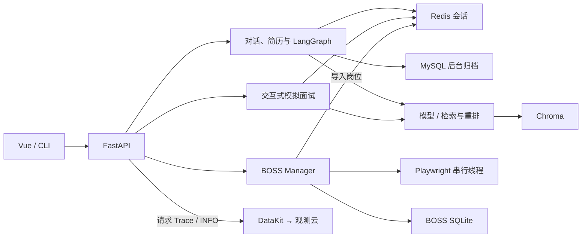

# 求职助手全系统架构评估

评估覆盖本机和容器入口、前端、API、求职工作流、交互式面试、模型与 RAG、BOSS、存储及遥测。

## 当前运行结构

## 本轮已实施

- FastAPI 生命周期在实际请求循环上初始化并探测 MySQL、Redis。启动失败或正常关闭时释放已创建的连接。本机入口和容器的 `uvicorn main:app` 共用该逻辑。
- LangGraph 执行由工作流模块提供，MySQL 后台归档由存储模块提供。对话、简历渲染和岗位导入共用 `CopilotState.to_session_snapshot()`，统一排除本轮输入、提示和执行轨迹。简历读取和导出直接调用 Redis 存储。
- 回归覆盖 ASGI 启动与请求使用同一事件循环、部分启动失败的连接释放、快照不写入本轮字段，以及聊天接口经过真实 LangGraph 的离线路径。

## 发现与交付顺序

| 优先级与范围 | 代码证据及影响 | 建议交付与验收 |
| --- | --- | --- |
| P0 会话一致性 | 对话、简历渲染和岗位导入分别读取并覆盖 Redis 快照。现有锁没有接入这几个写入口，并发时存在覆盖先提交更新的风险。 | 用版本校验统一会话写入，再给覆盖冲突明确的重试反馈。验收两条并发请求、会话过期和旧版快照兼容。 |
| P0 数据恢复 | MySQL 归档在响应后运行，多个表各自提交，读路径主要依赖有 TTL 的 Redis。进程中断可能留下部分归档，Redis 过期后也缺少统一恢复入口。 | 按会话版本事务提交归档，确定 Redis 未命中时的恢复规则。验收提交中断、迟到旧版本、Redis 过期与重建。 |
| P0 对外部署 | API 接受客户端传入的会话 ID，主应用路由未统一绑定调用方身份。本机使用回环地址，容器配置支持映射端口。 | 对外部署前加入身份认证、会话归属检查和允许来源配置。验收跨会话读写拒绝与本机访问兼容。 |
| P1 BOSS 执行 | 单例、浏览器线程和冷却状态由 API 进程持有。默认配置允许多个 worker，SQLite 共用无法同步各 worker 的浏览器状态。 | 先维持本机单 worker，后续将浏览器交给单一执行进程，持久化批次与待核对状态。验收进程重启、重复提交和平台结果核对。 |
| P1 Agent 与面试 | 生产工作流仍走固定 LangGraph 路由。`plan_mode` 和执行记录表已经存在，主链尚未调用。交互式面试有独立 Redis 状态。 | 先固定聊天与面试的会话契约，再用条件路由测试评估复合任务。选定一种主编排路径后分阶段接入，验收旧意图、复合意图和节点失败。 |
| P1 模型与 RAG | 主工作流与 BOSS 使用不同模型调用入口。异步检索内部调用同步 Chroma 查询，本机最近的启动日志显示知识库集合为空。 | 先定义模型预算、超时和降级，再按样本测量检索质量和阻塞时间。验收空库、模型超时和检索不可用；保留当前供应商切换方式。 |
| P2 前端与 CLI | 前端聊天会话主要保存在内存，BOSS 搜索另有浏览器缓存。长任务仍依赖 HTTP 连接，CLI 和页面各自解释响应。 | 服务端定义会话恢复和任务进度接口，页面与 CLI 共用状态契约。验收刷新恢复、主动中断和批次统计一致。 |
| P2 可观测性 | DataKit 已收到 HTTP 请求 Trace 与 INFO，接口层可见耗时和状态，但当前缺少存储归档、模型与 Agent 节点分段。 | 在共享工作流、归档和依赖调用处加子 Span 与失败计数。仅记录阶段、耗时和结果代码，验收数据可在工作空间查询。 |

会话一致性与数据恢复优先于扩展 Agent 数量。它们影响对话、简历、面试和岗位导入的共享数据，完成后才能为异步任务和失败重试提供可靠基础。
